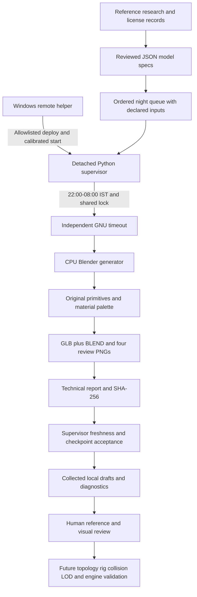

# Modeling pipeline and asset acceptance

Updated 20 November 2026. This document describes the **implemented** model-generation architecture and the route from a draft to a usable game asset. For commands and failure recovery use [OVERNIGHT_MODELING.md](OVERNIGHT_MODELING.md); for actual deployment/status evidence use [OVERNIGHT_HANDOFF.md](OVERNIGHT_HANDOFF.md). The first eleven-job batch has technically completed; that does not advance visual, period, cultural or engine acceptance.

## Product boundary

**Mumbai: Gully Heat** is an original, stylized open-world game grounded in real Mumbai. The user requires actual local buildings, landmarks and vehicle families, plus Indian/Maharashtrian character/clothing and chawl research. Stylization reduces rendering cost; it does not establish that generic geometry represents a particular real building or garment.

The current overnight batch addresses reference gaps with original procedural static studies. It is a geometry/export prototype, not a full asset factory or a playable game. These studies must pass reference review and later production gates before placement in a release. The selected district, reference year/year-band and surveyed or documented source example remain prerequisites for location-specific final art; see [PROJECT_BRIEF.md](PROJECT_BRIEF.md) and [PROJECT_RECORD.md](PROJECT_RECORD.md).

## Implemented architecture

Reference links are human research/provenance inputs. No part of the running generator downloads those pages, extracts their photographs, infers a model from text or reconstructs a scene from images. JSON `instructions`, `assumptions` and `review_checks` are retained briefs/metadata; the Python implementation determines which geometry is actually built.

| Layer | Implementation | Responsibility |
|---|---|---|
| Transport and control | [tools/remote_night.py](../tools/remote_night.py) | Existing SSH keys, fixed JSON RPC, allowlisted file transfer, clock calibration, detached launch, status and collection |
| Scheduling and evidence | [tools/night_queue.py](../tools/night_queue.py) | Night window, locks, bounded attempts, orphan deadline, atomic state, source fingerprints and accepted-output hashes |
| Job manifest | [jobs/night-queue.json](../jobs/night-queue.json) | Sequential job order, script/args, declared source dependencies, seven output paths and limits |
| Model specification | [jobs/specs/](../jobs/specs/) | Asset ID/kind, implemented numeric parameters, geometry cap, reference notes and review requirements |
| Build/export wrapper | [tools/build_queued_model.py](../tools/build_queued_model.py) | Factory-empty scene, metric units, generator dispatch, geometry metrics, GLB, review studio, renders, BLEND and report |
| Shared geometry | [tools/modeling/core.py](../tools/modeling/core.py) | Registered boxes/cylinders/beams/meshes/ellipsoids/lathes and a simple shared material palette |
| Character studies | [tools/modeling/characters.py](../tools/modeling/characters.py) | Fixed estimated adult bodies, contemporary/traditional garment massing, cap and pheta accessory studies |
| Chawl studies | [tools/modeling/chawl.py](../tools/modeling/chawl.py) | Parameter-bounded frontage, stairs, repeated galleries, low-rise courtyard rows and service props |

All current model geometry is created from original primitives. No external mesh, texture, celebrity likeness or third-party clothing archive is imported. Published reference photographs are not embedded as shipping textures. Third-party candidates still require their own archive, per-file license and rig/dependency audit before adoption in [THIRD_PARTY.md](THIRD_PARTY.md).

## One model attempt, step by step

1. The supervisor hashes the job definition, generator and explicitly declared inputs, acquires the shared heavy-work lock and records a running checkpoint with unique attempt log.
2. It launches Blender with `--factory-startup --disable-autoexec -b -t 8 --python tools/build_queued_model.py -- --spec jobs/specs/<id>.json`, inside the independent Linux timeout. The helper launches the supervisor at nice priority 10 and caps OMP/OpenBLAS thread environment values at eight.
3. The wrapper resolves its project root from its own location, validates the relative JSON/asset ID, creates `assets/generated/<id>/.attempt-*`, resets to an empty scene and sets metres.
4. A supported `kind` selects the character or chawl generator. Every model mesh is registered separately from presentation objects.
5. The wrapper updates transforms, calculates loop-triangle count and finite world-space bounds, and rejects empty geometry or a count above the spec's cap. Each selected model object receives its asset ID and pending-reference-review metadata.
6. It exports selected model geometry to `model.glb`, with custom extras and animations disabled, **before** adding the studio. The GLB excludes the presentation ground, camera and lights.
7. It creates an orthographic camera, presentation ground and three area lights, then renders preview/front/rear/side PNGs at 640 x 640 using CPU Cycles, 16 samples and denoising. The saved `model.blend` includes this editable review setup.
8. It verifies and hashes the six model/render files, promotes them one at a time with atomic file replacement, then writes/promotes `report.json` last. A failed promotion can leave mixed previous/new files; the supervisor must still accept the complete attempt.
9. The supervisor requires zero process exit, all seven nonempty fresh regular files and an `ok`/passed report. It saves each file's size and SHA-256 in state. This is a **technical** checkpoint only.

The report records `geometry_stage: original_procedural_blockout`, `human_review_required: true`, `cultural_architectural_review: pending`, `rigged: false` and `animations: 0`. Its own SHA-256 mapping covers the six model/PNG files; the supervisor's state additionally hashes the report.

## Prepared production studies

The [asset production plan's eleven-job inventory](ASSET_PRODUCTION_PLAN.md#eleven-job-study-inventory) owns the study list, per-asset triangle ceilings and next review requirements. [jobs/night-queue.json](../jobs/night-queue.json) owns actual order/enablement and runtime limits; each file under [jobs/specs/](../jobs/specs/) owns its implemented kind, geometry cap and brief. The five chawl and six character/outfit/accessory studies are original procedural drafts with human approval pending.

All eleven jobs use a 1,200-second attempt cap, at most two ordinary failure attempts and a 90-second minimum remaining window before a new launch. Triangle ceilings are current export rejection bounds, not target counts or proof of low-spec suitability. `smoke-chawl-bay.json` and `smoke-nauvari-study.json` are separate preflight specifications, not production-queue entries. A successful smoke render does not increment any of the eleven production completions.

## Geometry, style and dimensional behavior

The palette in `core.py` contains twenty simple color materials with roughness 0.85. These support readable plaster, concrete, wood, metal, cloth and skin massing. They are not a final texture atlas, material-count cap or completed implementation of the [brand guide](BRAND.md). Consistent silhouettes, proportions and readable color groups matter more than decorative detail at this stage. Do not add expensive transparent materials, dense folds or extra mesh parts without measuring their game cost.

Character bodies are estimated adult proportions assembled from separate primitive mesh parts. The wrapper accepts a spec `parameters` object, but current character generators use fixed estimated proportions/accessory dimensions; adding JSON body measurements alone does not change them. Separate body parts are not welded animation topology. The generator has no rig, skin weights, garment fitting, cloth simulation, facial blend shapes, retopology or walk/vehicle-entry tests.

Chawl parameters are numeric, finite and bounded before geometry allocation:

| Parameter | Default | Current clamp |
|---|---:|---:|
| `bay_width` | 3.0 m | 2.4-3.8 m |
| `room_depth` | 5.0 m | 4.0-6.5 m |
| `gallery_width` | 1.4 m | 1.2-2.0 m |
| `floor_height` | 2.8 m | 2.5-3.2 m |
| `bays` | 4 | 1-6, converted to integer |
| `floors` | 4 | 1-4, converted to integer |
| `courtyard_width` | 7.0 m | 4.0-12.0 m |

These are design estimates, not a measured survey. The baithi builder explicitly uses one storey even when the common input block contains `floors: 4`. The gallery study uses repeated dwellings and external circulation; it is not an exact named BDD block. Frontages have real door/window gaps, and door leaves have hinge-based origins. The stairs include visible treads/landings/support geometry; there is no generated gameplay collision ramp, navigation mesh or proof that a character can traverse them.

## Implemented support for production gates

The [asset production plan](ASSET_PRODUCTION_PLAN.md#acceptance-sequence-and-evidence) owns the A0-A5 acceptance sequence. Record results per asset; never collapse those gates into the word complete. The implemented freshness/export/triangle/hash checks are preliminary technical evidence and do not advance cultural or production acceptance automatically.

| Production gate | Evidence relevant to this pipeline | Current implemented support |
|---|---|---|
| A0. Reference and acquisition | Source creator/file/version/license/dependencies, allowed commercial/adaptation use, date/location/garment context and intended use | Original procedural ownership note and spec reference list; no automatic license adjudication |
| A1. Visual, cultural and architectural identity | All views, believable silhouette/construction, reference match, scale and appropriate local review | Four review PNGs and metadata; human review pending |
| A2. Topology and materials | Usable topology/normals, pivots, UV/material plan, LOD intent and reusable module/character structure | Finite bounds, nonzero geometry, triangle ceiling, valid fresh files and hashes; no complete topology/material/LOD gate |
| A3. Rigs, collision and function | Common rig/weights, idle/walk/turn/vehicle tests; door/gallery/stair/courtyard traversal and collision | No rig, collision/navigation generation or engine import test implemented |
| A4. Engine import and populated-scene performance | Named target machine, repeatable populated route, CPU/GPU frame time, RAM/VRAM, draw calls, material/object/texture cost | No populated engine performance gate passed |
| A5. Production adoption | Accepted version/ID, editable source, retained provenance/credits and regression evidence | Generated IDs and technical hashes only; no shipping adoption claimed |

The user selected Windows PC and Android together, with an integrated-GPU/8 GB Windows class and Android 12 as the OS target. The provisional PC budget is 720p/30 FPS; actual PC CPU/GPU/driver and the Android phone's SoC/RAM/GPU remain to be specified and measured through real exports. Require platform-specific touch/input, memory, frame-time and suspend/resume checks. One 300-triangle bay can still be expensive when repeated as many meshes/materials; one low-triangle NPC can still fail animation or overdraw budgets. Count instances, materials, objects, texture memory and visibility as well as triangles.

For the selected **1990–1995 Bandra West** setting, keep period-appropriate everyday street dress alongside traditional/ceremonial clothing in appropriate contexts. Current generator labels and reference links do not establish period fit. A generic sari is not automatically a nauvari/kashtha drape. Review leg division, rear tuck, pleats, shoulder/pallu route, blouse fit and cloth intersections; confirm cap/pheta form and tying style rather than approving an accessory by color. Read [INDIAN_MAHARASHTRIAN_CHARACTERS.md](../research/INDIAN_MAHARASHTRIAN_CHARACTERS.md).

For chawls, distinguish multistorey shared-gallery dwellings from low-rise courtyard forms and generic informal/shanty construction. Select a dated reference belonging to the chosen district, preserve characteristic dwelling repetition/circulation, and document deliberate gameplay compression. Read [CHAWL_MODEL_RESEARCH.md](CHAWL_MODEL_RESEARCH.md).

## Known preflight defects and evidence

The technical smoke bay exported at **300 triangles, 25 mesh objects, five materials**, approximately **3.0 x 6.4 x 2.8 m**. Its doorway/gallery structure is a component study. Material/context, matching to a selected real building, collision and usable circulation remain unapproved. See [bay report](../reports/preflight/chawl-bay-report.json) and [preview](../reports/preflight/chawl-bay-preview.png).

The technical smoke nauvari exported at **3,240 triangles, 33 mesh objects, eight materials**, approximately **0.896 x 0.350 x 1.691 m**. Review found that the lower drape reads too much like loose trousers, the pallu is a flat surface, and shoulder/neck intersections and cloth construction need refinement. It is not an accepted authentic nauvari outfit. See [report](../reports/preflight/nauvari-report.json), [preview](../reports/preflight/nauvari-preview.png) and [rear](../reports/preflight/nauvari-rear.png).

Those results validate the actual Blender path, render/export and measurement machinery for two bounded studies. They do not validate the whole eleven-job batch, a common rig, a complete Mumbai building, garment authenticity or gameplay readiness.

## Future acquisition and model-building paths

| Path | Present status | Evaluation needed before production |
|---|---|---|
| Reuse commercial-safe open models | Catalogue/source metadata researched; no archive adopted in this task | Download exact candidate, inspect per-file license/credits/textures/rig, import and measure adaptation cost |
| MakeHuman or another common body/rig base | Candidate workflow only; not installed/configured into this queue | Verify actual version/asset licenses, body variety, clothing compatibility, rig export and one animation/import test |
| Image-to-3D or multi-view reconstruction | Not configured; no service credentials, local model weights, reconstruction backend or GPU allocation established | Pick backend/hardware, verify input/output terms, build authorized reference pack, compare cleanup plus accepted-asset time against reuse/manual work |
| Photogrammetry/survey of a real building | Not implemented | Capture permissions/reference rights, measured scale, coverage, cleanup, texture/LOD/collision budgets and local accuracy review |
| Retopology, UVs/atlas, rigging/weights and animation | Not implemented in the procedural worker | Select reusable pipeline, test one complete hero/NPC and a small world module in the chosen engine |
| Broader continuous Codex agents | Not deployed as an unattended service | Explicit bounded task contracts, real execution capability, spending/retry limits, review/integration capacity and secrets handling |

The existing CPU Blender node supports deterministic procedural construction and review renders. It is not evidence that a modern image-to-3D stack is available or that more Codex budget removes human art/integration work. Compare methods using **time and cost to an accepted in-game asset**, including reference selection, legal/provenance checks, cleanup, rigging, collision and rework.

## Reproducibility and known implementation limits

A job's fingerprint includes canonical queue JSON, its wrapper script and explicitly declared input file bytes. Keep every actual source dependency declared when extending a generator. Current chawl entries list their spec, `core.py`, `__init__.py` and `chawl.py`; the wrapper also eagerly imports `characters.py`, which is not declared for those jobs. A change to that imported file can therefore affect a chawl launch without changing that job's fingerprint. Review this dependency gap before extending cross-module imports; it does not justify deleting checkpoints.

Current render/BLEND bytes are not guaranteed bit-identical between Blender versions, timestamps, platforms or changed render behavior. Pin the toolchain and keep actual output hashes as evidence. The checkpoint hash detects an unexpected changed file; it is not a claim of byte-for-byte rebuild determinism.

The queue can resume attempts and bound subprocesses. It cannot recover unsaved artistic work inside Blender, assemble mixed partial exports into a valid model, select the best-looking candidate, clean its disk automatically or turn a technically valid static model into an accepted game asset. Preserve logs and `.attempt-*` evidence until diagnosis is complete, and use [the runbook](OVERNIGHT_MODELING.md) for controlled correction/requeue.
